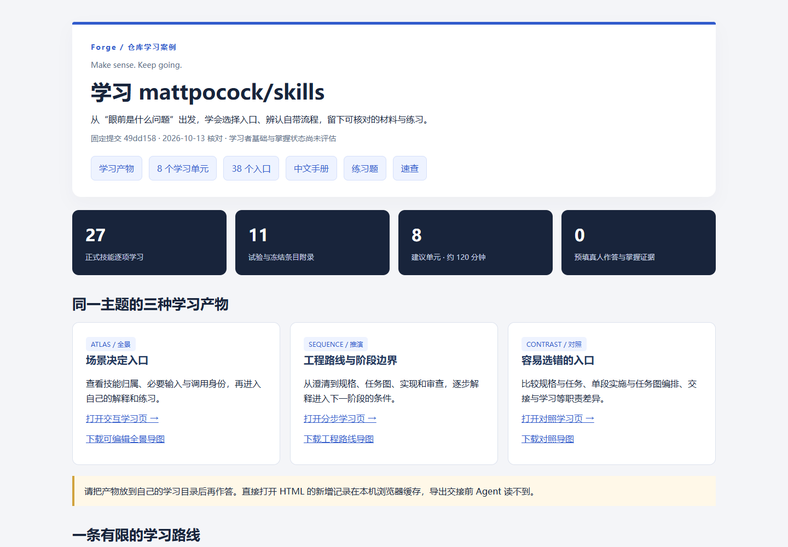
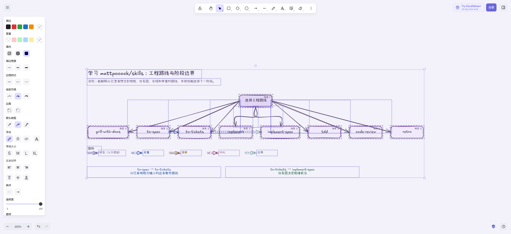
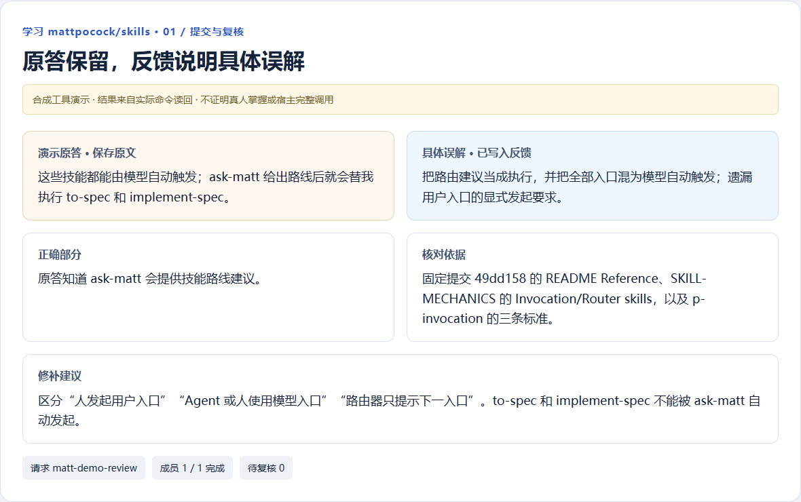

# Forge

**Make sense. Keep going.**

**帮你学新知识、整理资料、检查答案，并保存进度。**


Forge 是可以安装到 AI 助手里的学习技能。你把文章、课程笔记或想学的主题交给它，它会结合例子讲解，让你自己试一试，再根据回答说明哪里需要补充。需要时，它还能生成学习网页和思维导图，保存回答和进度，下次接着学。

主视觉及下方两张展示图以实际产物为参考，经 AI 合成和重绘；案例中的实际截图另列，方便核对。

例如，你有一份看不太懂的课程笔记，安装 Forge 后可以这样说：

```text
/forge 带我学习这份笔记，用生活中的例子讲解，再让我自己试一试。
我今天有 20 分钟，结束前请保存进度，并告诉我下次从哪里继续。
```

## 能帮你做什么

| 你遇到的情况 | 可以让 Forge 做什么 |
| --- | --- |
| 想学一个新主题，不知道从哪里开始 | 了解你的目标，用例子讲解，安排你能尝试的练习 |
| 有文章或笔记，内容比较零散 | 整理成学习网页、思维导图和练习，保留资料出处 |
| 觉得懂了，但怕自己理解有漏洞 | 根据你的解释提出问题，一次问一个，等你回答 |
| 已经做了题，想知道哪里答错 | 读取已保存的答案，逐题说明问题和修改建议 |
| 今天时间不多，不知道先复习什么 | 根据已有记录，安排这次先复习哪些、哪些留到以后 |
| 想继续上次的学习 | 读取保存的进度、回答和反馈，从上次停下的地方继续 |
| 想看看自己学了一段时间后有什么变化 | 回看以前的解释、后来的修改和反复出错的地方 |

## 怎样帮助你学习

先看清知识的整体骨架，再自己解释、尝试作答，结合反馈修正，把需要再练的地方留到下次。Forge 把下面这些做法用在学习过程中，你可以按需要选择，不必每次全部走完。

| 学习做法 | 在 Forge 里怎样用 |
| --- | --- |
| **先看知识骨架** | 围绕学习目标整理概念，用学习网页和思维导图看清层级、前置知识，以及因果、对比和应用关系 |
| **费曼式解释** | 用自己的话说明一个概念，结合材料和反馈找出解释中的缺口，再补充、修正或换个例子尝试 |
| **苏格拉底式追问** | 根据你的解释，一次追问一个前提、依据或边界问题，等你自己回答 |
| **借鉴康奈尔的提问与自测思路** | 记录自己的解释和总结，提出自己的问题，把问题留作后续练习；这里没有采用完整的三栏笔记格式 |
| **主动回忆与分步提示** | 在练习页隐藏参考，先尝试独立作答；需要时逐步查看提示，记录实际使用的帮助，保留原答案 |
| **从解释到变式、应用** | 根据已保存的作答和导师评价，从现有题目中选择后续练习；缺少合适题目时说明缺项 |
| **间隔复习** | 有可用作答和评价后，按 Forge 自定义的简单间隔规则安排下次复习；也可以结合今天的时间选择先复习什么 |

讲解、追问和答案核对由 AI 助手结合材料完成；随附工具负责生成产物、保存记录、记录帮助使用情况，并根据记录和评价选择练习、安排复习。AI 的判断仍可能出错，不能仅凭生成了产物或完成了练习就认定已经学会。方法出处与借鉴范围见[来源与灵感边界](skill/forge/references/sources.md)。

## 开始使用

**第一步：安装到你正在使用的 AI 助手中。**

不熟悉安装命令，可以把下面这段话交给你的 AI 助手：

```text
请从 https://github.com/ChengYueCode/Fogre 为我正在使用的 AI 助手安装 Forge。
请安装 forge 和五个 forge-* 技能，共六个，检查能否使用，告诉我接下来怎么开始。
如果已经装过，请先核对现有版本；缺少必要环境时，请说明需要我做什么。
```

你的 AI 助手需要支持安装技能、读取和保存文件、运行命令。生成学习网页和保存记录还需要 Node.js 20 及以上，这是运行随附工具所需的软件；可以让助手先检查。具体要求见[安装与使用](docs/installation.md)。

熟悉终端的用户也可以运行：

```sh
npx skills@latest add ChengYueCode/Fogre
```

在安装菜单展开 **Forge Skills**，选择 **Select All**（全部选择），再选择你正在使用的 AI 助手和安装范围。默认只在当前项目使用；需要在其他项目也使用，可增加 `--global`。安装命令中的名字不带 `/`。

**第二步：确认助手已经加载 Forge，然后开始聊天。**

在聊天中输入 `/forge`，后面写想做什么，并提供相关材料。例如：

```text
/forge 把这篇文章整理成学习网页和思维导图，保留我没有弄懂的问题，今天先不提问。
```

后续正常交流就可以。不懂时说“换个例子”；想结束时说“今天先停，保存进度”；下次说“先找出我上次的学习记录，再接着学”。

## 五个只做一件事的技能

**只装 `forge`，也能用 `/forge` 请求下面所有功能。** 如果想直接使用 `/forge-organize` 等名字，需要另装对应技能；选择安装全部六个就能一起使用。

| 技能 | 你要提供什么 | 它会做什么 |
| --- | --- | --- |
| `/forge-organize` 整理资料 | 文章、笔记等材料 | 整理成学习网页、可编辑思维导图和练习，保留出处与疑问 |
| `/forge-question` 检查理解 | 你自己的解释或推理 | 每次问一个问题，等你回答；只在聊天里提问，不直接给答案或保存文件 |
| `/forge-review` 检查答案 | 已保存的学习记录，其中要有你提交的答案 | 逐题说明哪里答对、哪里有问题、怎样修改，并保存反馈 |
| `/forge-review-plan` 安排复习 | 已有学习记录，以及今天可用的时间 | 说明先复习什么、为什么选这些、哪些留到下次；明确要求保存后才写入记录 |
| `/forge-insights` 回看变化 | 已有学习记录 | 把以前的解释、答案、修改和反馈放在一起，回看理解上的变化 |

例如，提供课程笔记后可以说：

```text
/forge-organize 整理这份课程笔记，做成学习网页和可编辑思维导图，保留疑问和来源。
```

检查答案、安排复习和回看变化需要能读取的学习记录。只有旧聊天时，先让助手确认记录是否已经保存。更多例子见[可以怎样请求 Forge](skill/forge/references/usage-examples.md)。

## 会得到什么


是否生成文件，取决于你这次想做什么。只检查解释时，可以直接聊天。

| 得到的内容 | 用来做什么 |
| --- | --- |
| **学习网页** | 用浏览器打开，查看知识之间的关系、阅读解释、做练习和记笔记 |
| **可编辑思维导图** | 把知识之间的关系画出来；用 Excalidraw 打开后，可以移动节点、修改文字和布局 |
| **学习记录** | 保存目标、答案、修改、反馈和暂停位置，方便下次继续或安排复习 |
| **聊天中的问题、解释或复习安排** | 直接和 AI 助手交流；是否另存记录，以这次请求和实际保存结果为准 |

## 学习记录怎么保存

记录保存在你选择的电脑文件夹里。让助手告诉你保存在哪里，并检查是否真的保存成功。换电脑或换项目时，需要带上这些文件，才能接着读回以前的记录。

在学习网页上做题时，有两种保存方式：

- **助手给你一个本地网页地址**：打开后，如果保存服务正在运行，答案可以直接存进学习文件夹。
- **你直接双击 HTML 文件打开**：新增答案先留在当前浏览器里。点击页面的“导出状态”，把文件交给助手导入后，它才能检查这些答案。

如果不确定正在用哪种方式，可以问：“我刚才的答案保存在哪里？你现在能读到吗？”详细操作见[保存与反馈交接](docs/installation.md#保存与反馈交接)。

AI 的解释和判断可能出错，可以让它回到原始材料核对。整理出了网页、做完了题，也不代表所有内容都已经学会。

## 看一个完整示例

这个示例学习的是 **mattpocock/skills**：一套帮助 AI 助手完成软件开发任务的技能。它展示 Forge 怎样整理一份较复杂的资料；你自己的学习主题可以是文章、课程笔记或其他知识。

资料包含中文手册、8 个学习单元、45 道练习、思维导图和资料出处，依据固定版本 `49dd158` 整理。详细的 38 个技能索引见[全套示例](examples/mattpocock-skills/README.md)。


**实际产物截图：** 以下保留页面和独立导图编辑器的实际画面。

**整理后的资料首页：**



**可以继续编辑的思维导图：**



**保存原答案，再说明错误和修改建议：**



操作示范使用事先编写的示例答案，不是真人学习结果。示例中的初始记录没有替你填答案；你自己的理解和进度仍需通过实际回答记录。

## 想了解更多

[安装与使用](docs/installation.md) · [更多请求示例](skill/forge/references/usage-examples.md) · [详细使用说明](docs/github-introduction.md) · [展示图与来源](docs/visual-showcase.md)

[环境支持](docs/support.md) · [安全与隐私](SECURITY.md) · [参与贡献](CONTRIBUTING.md) · [MIT 许可证](LICENSE)
