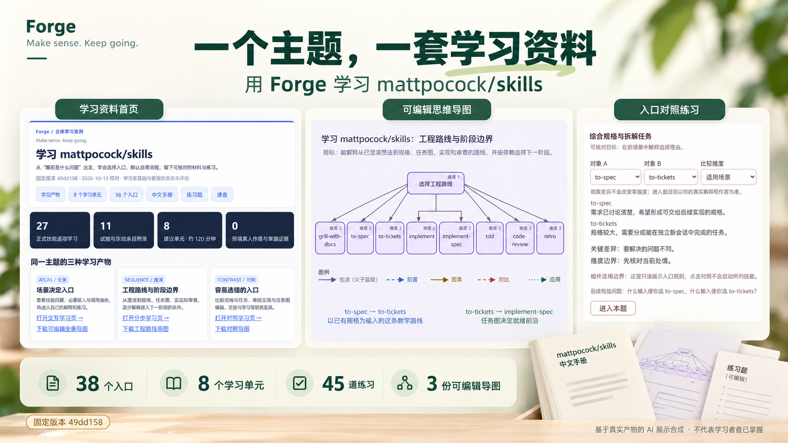
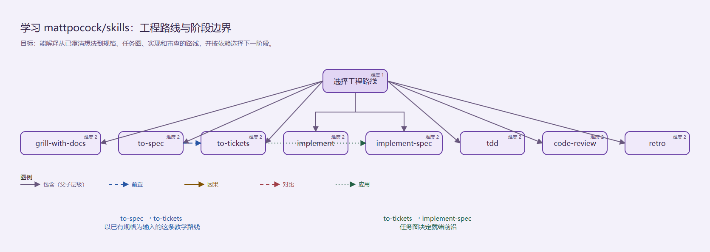

# Forge 展示图与实际图片

这套图按当前 **Forge / Make sense. Keep going.** 设计，中文定位为“帮你学新知识、整理资料、检查答案，并保存进度”。绿色取自主技能的界面信息，面向普通学习者；mattpocock/skills 是一个具体资料整理案例。

## 三张展示图

| 图片 | 在 README 中的位置 | 表达的内容 |
| --- | --- | --- |
| [主视觉](assets/showcase/forge-hero.png) | 开场定位 | 学新知识、整理资料、检查答案、保存进度；保存卡片取自实际暂停与恢复报告 |
| [学习与继续](assets/showcase/forge-learning-flow.png) | 会得到什么 | 提供资料、讲解与尝试、检查与修改、保存与继续；学习者实际参与 |
| [完整案例](assets/showcase/forge-case-study.png) | 完整示例 | 同一主题的资料首页、导图、对照练习，以及 38 个入口、8 个单元、45 道练习、3 份原生导图 |

三张图由内置 **image_gen** 以实际截图为参考生成，包含视觉合成、布局优化和文字重绘。它们用于介绍技能，不是未经修改的页面截图；细小界面文字、节点位置和连线以原产物为准。原答示范来自事先编写的示例，不是真人学习结果。

学习流程图右上角的人物已按用户提供的插画形象替换：黑色卷发、黑框眼镜、蓝色外套与白色内搭，融入原来的持笔学习姿态。参考图只登记哈希与形象说明，原始上传文件不随公开资料分发。

## 可以核对的实际图片

[实际图片清单](assets/cases/manifest.json)包含 20 张图片：学习资料首页、目录搜索、交互学习页、练习、来源、原生编辑器、复核与恢复报告，以及三份最终 SVG 的原始尺寸截图。每张都记录实际操作、来源文件与图片 SHA-256；保留的独立编辑器画面按清单记载的采集范围理解。

公开源码按 Git 属性统一为 LF 换行，并清理了行末排版空白。若文本在采集后仅整理了这些格式，清单另保留 `captureSourceSha256`，而 `sourceSha256` 指向当前文件；图片未改写。生成图的定位依据也保留统一换行前的输入哈希，避免把发布格式整理当成重新生成。

| 最终产物 | 实际图片 | 可编辑文件 |
| --- | --- | --- |
| 技能全景 | [完整 SVG 实际图片](assets/cases/mp-map-overview.png) | [原生导图](../examples/mattpocock-skills/overview/map.excalidraw) |
| 工程路线 | [完整 SVG 实际图片](assets/cases/mp-map-workflow.png) | [原生导图](../examples/mattpocock-skills/workflow/map.excalidraw) |
| 易混入口对照 | [完整 SVG 实际图片](assets/cases/mp-map-comparisons.png) | [原生导图](../examples/mattpocock-skills/comparisons/map.excalidraw) |

全景原图宽 8775 像素，保留全部节点；页面内缩略图适合看结构，阅读文字可打开原图或原生导图。

## 来源、复用与重做

当前图的文件哈希、品牌依据和参考图片见[展示图清单](assets/showcase/manifest.json)；完整提示词与主视觉局部修正见[生成提示词](assets/showcase/PROMPTS.md)。实际图片的来源文件哈希应先与当前产物核对，再作为重新生成的输入；重新生成不保证与现有图片逐像素一致。

图片以 PNG 随公开源码候选分发。宣传使用时保留 AI 合成的说明；核对能力或操作时链接实际图片和原产物。素材说明见[第三方与来源](../THIRD_PARTY.md)。

[回到 README](../README.md) · [完整学习资料](../examples/mattpocock-skills/README.md)
