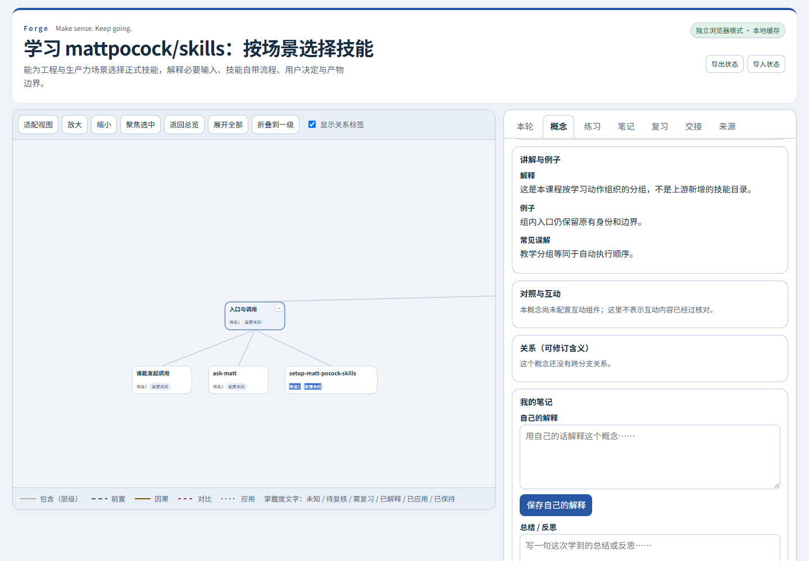
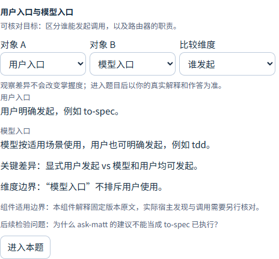
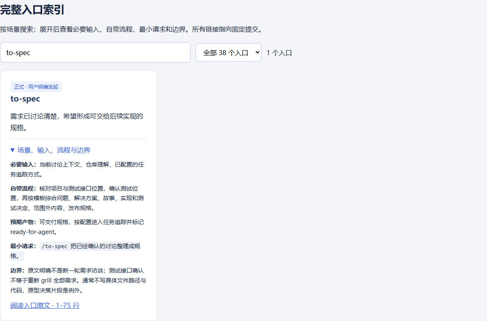
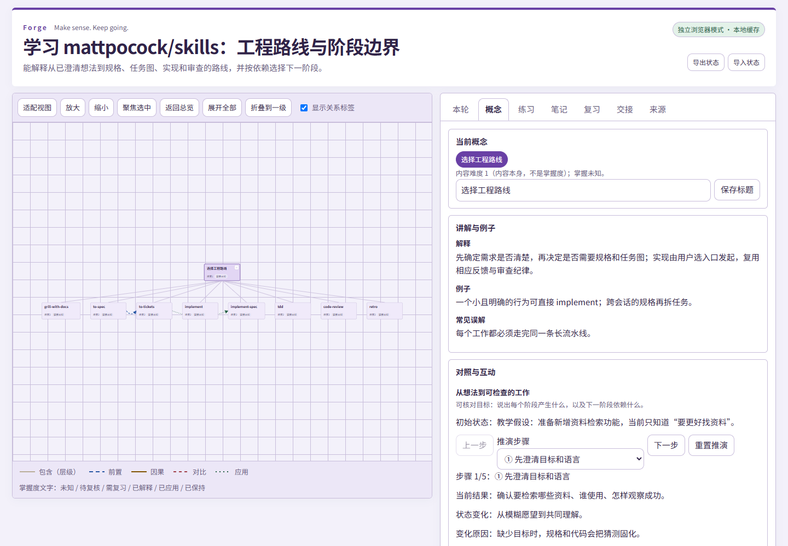
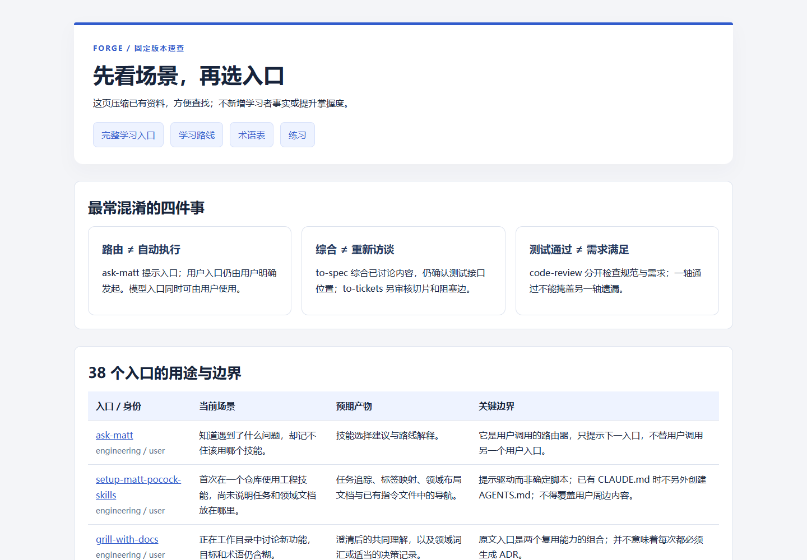
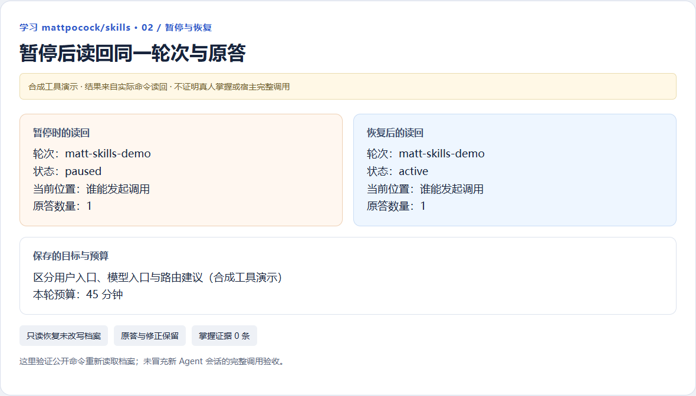
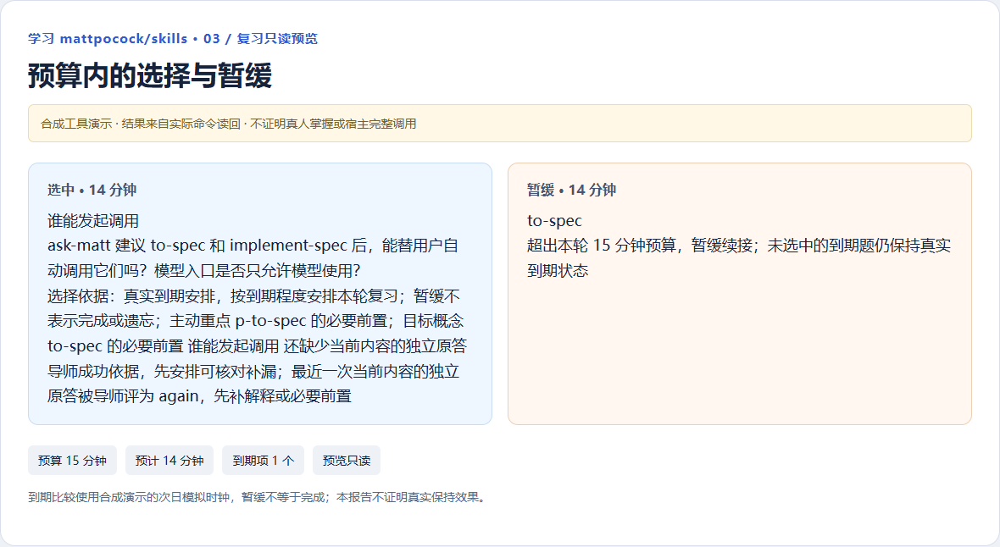
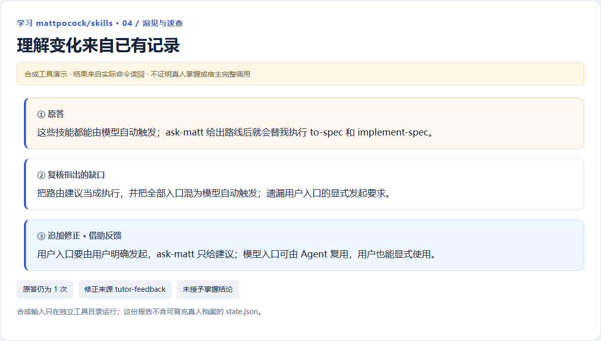
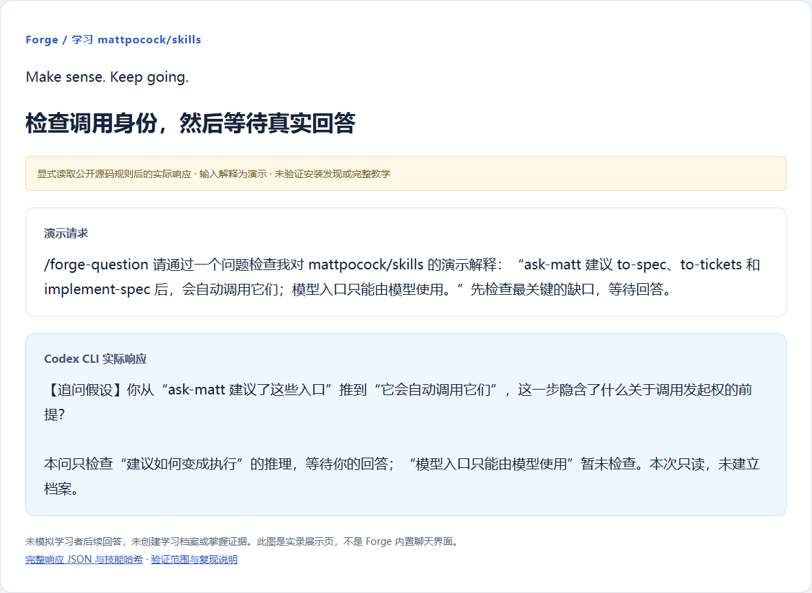

# 案例：学习 mattpocock/skills 的全套资料

**场景**：想学会在不同工程与生产力问题中选择适合的技能，分清哪些信息由你提供、哪些步骤已由技能负责，以及什么结果才算完成。

来源固定到 [mattpocock/skills 的 49dd158 提交](https://github.com/mattpocock/skills/tree/49dd158d1076134a641b33efb035946536778336)，2026-10-13 核对。完整索引 38 个入口：27 个正式技能、7 个试验入口、4 个冻结工具；弃用目录为空。中文讲解、学习顺序和教学情境由 Forge 编写，不是上游官方教程。

## 你可以直接拿到什么

| 资料 | 用途 |
| --- | --- |
| [完整资料入口](index.html) | 选择学习页、搜索入口、查看路线和来源 |
| [中文手册](HANDBOOK.md) | 38 个入口的场景、必要输入、自带流程、产物、边界和最小请求 |
| [8 单元路线](ROUTE.md) | 约 120 分钟的建议安排；每单元约 15 分钟，有可检查成果 |
| [45 道练习](EXERCISES.md)与[作者参考解释](ANSWERS.md) | 原答区、协助来源与标准；参考单独存放 |
| [场景速查](quick-reference.html)与[术语速查](TERMS.md) | 快速定位和打印复习 |
| [来源地图](SOURCE-MAP.md)与[来源清单](sources.json) | 固定版本、路径、行范围、107 个文件的哈希及范围说明 |
| [任务目标](MISSION.md)与[空白记录模板](LEARNING-RECORD-TEMPLATE.md) | 明确整理目标，保留未知基础和空白表现 |
| [技能全景学习页](overview/index.html) | 关系探索、调用身份对照、概念解释和检索练习 |
| [工程路线学习页](workflow/index.html) | 逐步推演进入下一阶段需要什么 |
| [易混入口学习页](comparisons/index.html) | 五组入口对照以及摘要与入口细则的来源差异 |

三份学习页分别附带 `model.json`、初始 `state.json`、`map.excalidraw`、`map.svg`、`quality.json` 和质检读回。初始档案没有真实作答、学习轮次或掌握证据。

## 可以怎样请求 Forge

**先拿完整资料，暂时不提问：**

```text
/forge-organize 按固定提交整理 mattpocock/skills。
生成中文手册、学习路线、交互学习页、可编辑导图、练习、参考解释和来源地图。
保留规则、教学建议与尚未验证部分的区别，今天先不现场提问。
```

**准备自己学习时：**

```text
/forge 使用这套 mattpocock/skills 材料带我学习。
这次先理解用户入口、模型入口与 ask-matt 的边界，有 15 分钟。
先让我解释，再根据实际回答决定怎样讲解。
把我的产物和真实记录放在 learning/mattpocock-skills，结束前保存并告诉我怎样继续。
```

技能已安装并加载后再使用对应入口。请求中可提供材料目录；阅读上游原文不授权安装、推送、发送信息或修改个人配置。

## 实际图片

原始尺寸的三份最终导图图片：[技能全景](../../docs/assets/cases/mp-map-overview.png) · [工程路线](../../docs/assets/cases/mp-map-workflow.png) · [易混入口对照](../../docs/assets/cases/mp-map-comparisons.png)。包含全部节点，原生文件可编辑；[Forge 展示图](../../docs/visual-showcase.md)以这些实际产物为参考，经 AI 合成和重绘。

完整资料总入口：


技能全景与调用身份：





在索引中搜索并展开 to-spec，能看到必要输入、原文自带流程和边界：



工程路线按步骤推演，实际点击至第 5 步，刷新后仍恢复该观察位置；观察不生成作答或掌握证据：




比较 to-spec 和 to-tickets；进入本题后，参考初始隐藏，截图没有填入代写答案：


原生工程路线导图实际加载到独立 Excalidraw 编辑器并选中元素。编辑器不是 Forge 内置组件；此图不证明实时 MCP 或编辑后往返验收：


[全景原生导图](overview/map.excalidraw) · [工程路线原生导图](workflow/map.excalidraw) · [对照原生导图](comparisons/map.excalidraw)

场景速查与来源边界：




## 保存、复核与续接的证据

以“ask-matt 的建议等于自动执行”为**合成工具输入**，实际执行 CLI 并生成[读回报告](tool-demo/index.html)。报告包含原答、反馈、借助反馈的修正、暂停与恢复、15 分钟复习预览和洞见；完整命令在[读回 JSON](tool-demo/readback.json)。








原答仍为 1 次，修正标明 `tutor-feedback`，掌握证据为 0；模拟次日时钟只演示调度，不证明真实保持效果。合成档案只在独立临时工具目录执行并清理，公开的是报告，不交付可冒充真人历史的合成 `state.json`。

本主题另有[已保存的单次提问实录](question/index.html)：按采集时公开 Forge 源码提问规则和本材料产生，只检查一个缺口并等待，没有模拟学习者后续回答。响应中的入口哈希标识当时版本；品牌与描述刷新未重新执行该会话，不据此声明新版宿主安装发现或完整持续教学通过。



## 下载后自己打开与保存

GitHub 不执行学习页 HTML。下载源码或资料 ZIP 后，本地打开 `index.html`，再进入三份学习页。直接打开页面的新记录在本机浏览器缓存，导出交给 Agent 前，它不能宣称已经读到。

希望创建自己的标准学习目录并自动存档，可从源码根目录运行：

```sh
node bin/forge.mjs build examples/mattpocock-skills/overview/model.json --out learning/mattpocock-skills --svg
node bin/forge.mjs quality-write --out learning/mattpocock-skills --quality examples/mattpocock-skills/overview/quality.json
node bin/forge.mjs build learning/mattpocock-skills/model.json --out learning/mattpocock-skills --svg
node bin/forge.mjs library register --topic mattpocock-skills --out learning/mattpocock-skills
node bin/forge.mjs serve --out learning/mattpocock-skills --port 0
```

已有目录先核对记录；同一有效目录重建保留真实原答和导图编辑。整理资料不强制创建教学轮次，正式学习时由 Agent 根据真实输入安排。

维护者复现资料：`node scripts/build-case-studies.mjs --out .scratch/my-mattpocock-materials`，输出目录必须尚不存在。单次 Agent 实录要重新执行与核对，不能复制旧输出冒充新调用。截图脚本需要 Playwright、本地 Chrome 与访问独立编辑器的网络。

[图片来源与哈希](../../docs/assets/cases/manifest.json) · [验收说明](../../docs/skill-acceptance.md) · [上游 MIT 许可](UPSTREAM-LICENSE.txt)
